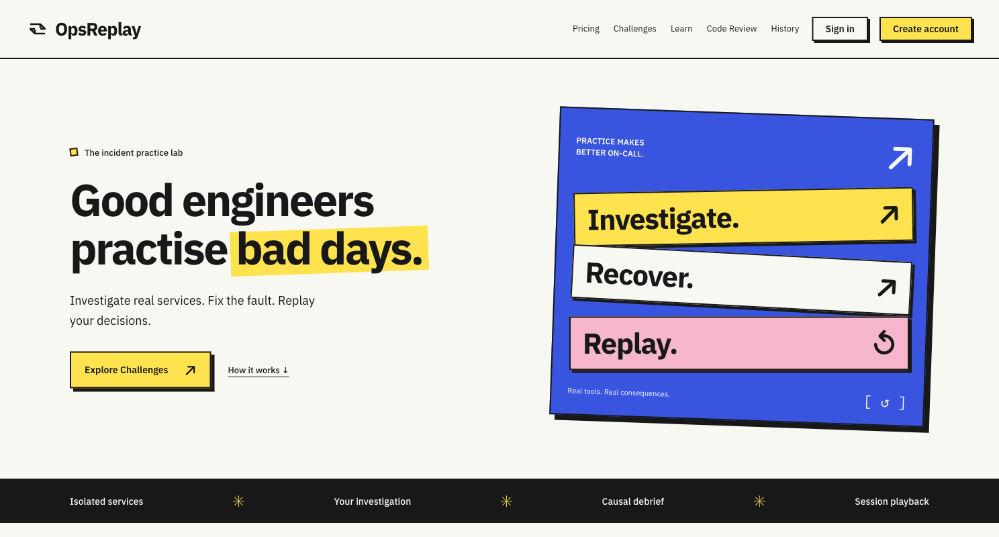
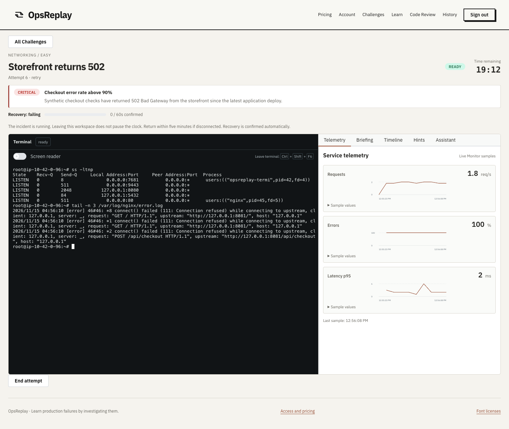
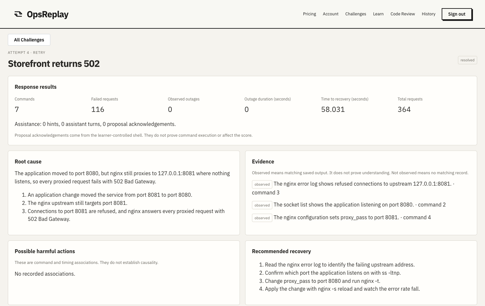
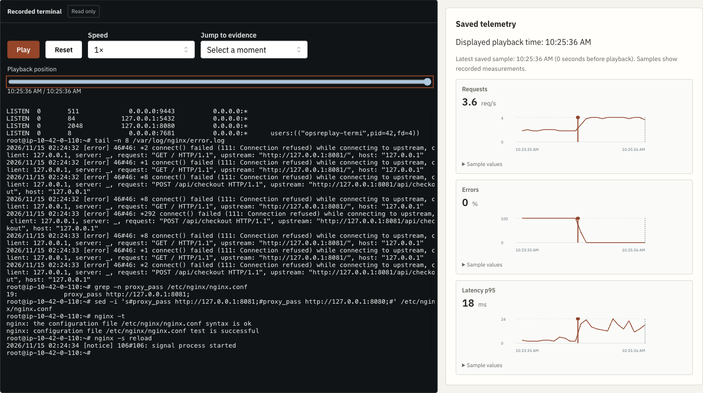
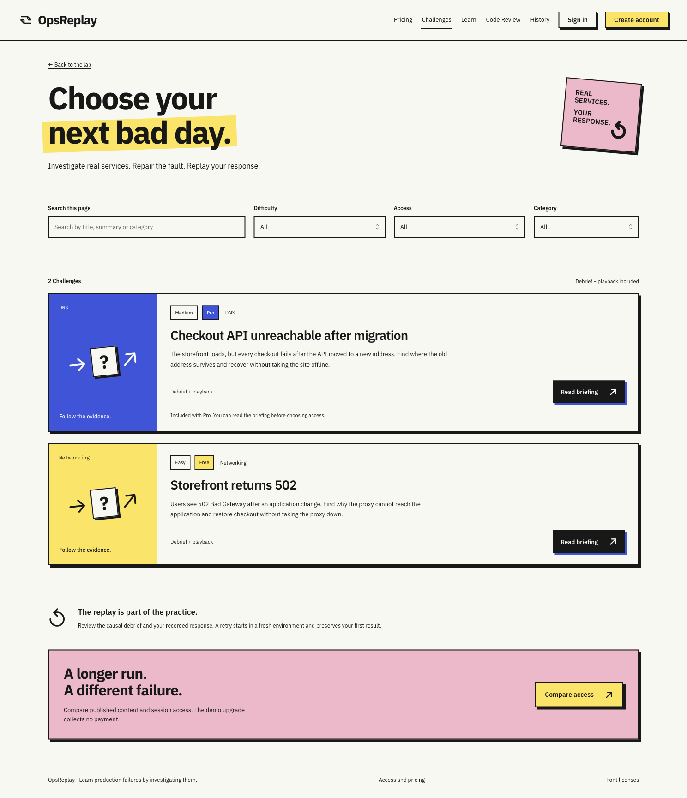
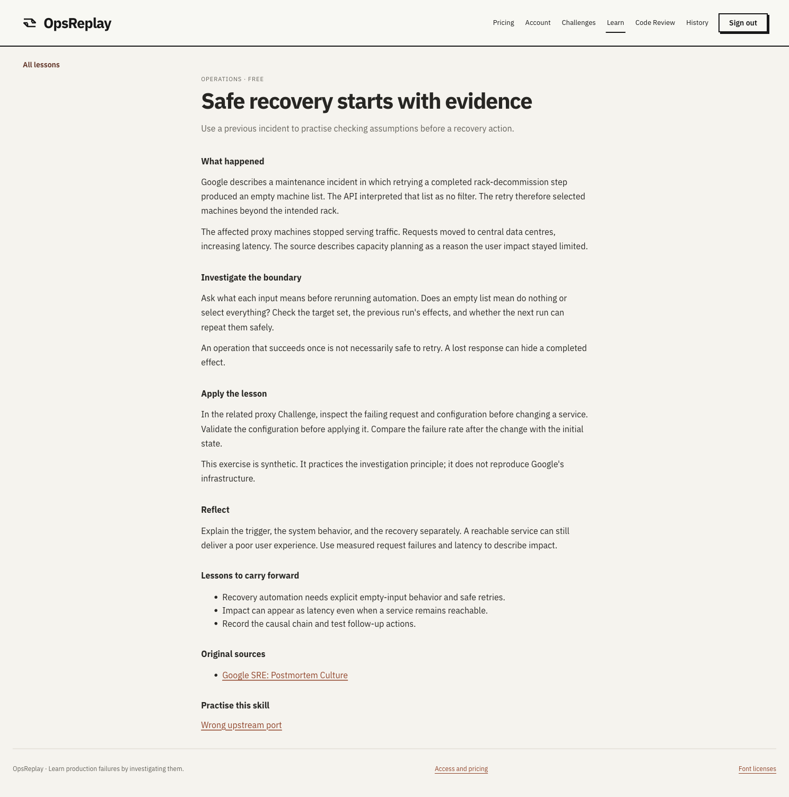
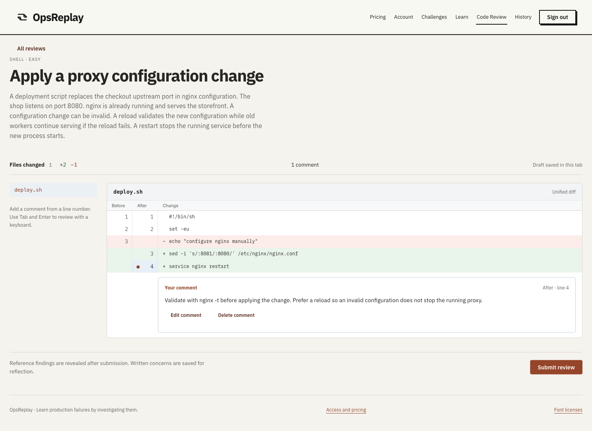

# OpsReplay

Learn production failures by investigating them.

OpsReplay is a production-engineering learning platform for students and junior
engineers. A learner enters an isolated, deliberately misconfigured environment,
investigates it with real tools, repairs the fault, and reviews a deterministic debrief
and session playback.



## Product tour

These screenshots show the AWS demo on 15 November 2026. They remain available
here after the temporary deployment is removed. [Capture details](docs/screenshots/README.md).

**Investigate real services.** Use the terminal alongside live request, error and
latency measurements. Each attempt runs in its own isolated environment.



**Understand the recovery.** The debrief shows measured response results, the root
cause, observed evidence and recommended recovery steps.



**Replay the investigation.** Recorded terminal output and telemetry share a
playback position. Seeking through the recording does not execute commands.



<details>
<summary>Explore the Challenge catalogue, Learn and Code Review</summary>

**Challenge catalogue.** Browse the published exercises by difficulty, access and category.



**Learn.** Read curated incident explanations, practical lessons and original sources.



**Code Review.** Add concerns to lines in a diff, then compare them with the
reference findings after submission. Written concerns are not automatically graded.



</details>

## Current status

**Latest demo checks, 15 November 2026:** both published Challenges passed
investigation, repair, sustained recovery, saved debrief and recording checks on
AWS. Browser sign-in, debrief and playback were also checked. The rebuilt images
fixed all 64 reported PostgreSQL HIGH findings; 16 library HIGH findings remained
under a restricted demo exception. This does not establish production clearance.
The optional assistant's latest live replies failed; terminal investigation and
hints remain available. Learner evaluation, larger capacity tests and final cost
comparison remain pending. See the [demo checkpoint](docs/checkpoints/2026-11-15-demo.md).

| Area                                     | Status                                                                              |
| ---------------------------------------- | ----------------------------------------------------------------------------------- |
| Reference Challenge, Monitor and Gateway | Implemented; real fault, harmful action and recovery checked on AWS                 |
| Session lifecycle and results            | Implemented; start, resume, end, debrief, playback and retry checked on AWS         |
| Web application and account APIs         | Fresh inbox sign-up checked; two test learners used for access and ownership checks |
| AWS infrastructure                       | Temporary AWS deployment and teardown checked; demo availability is temporary       |
| Learn library                            | Implemented; one Free and one Pro lesson have retained published metadata           |
| Code Review reads and submissions        | Inline editing, draft persistence, saved result and lost-response recovery checked  |
| Learner history                          | Implemented; saved review reopened through History in the 23 October checkpoint     |
| Challenge assistant                      | Implemented; historical AWS proposal check passed; latest demo replies failed       |
| SaaS identity and demo upgrade           | Checked on AWS; default-off, fixed-window grant, no payment or subscription created |
| Scenario and system evaluation           | Full local repeats and 450 AWS GETs passed; capacity, final costs and pilot pending |

The [17 October browser checkpoint](docs/checkpoints/2026-10-17-browser.md) records
the revision, results, findings and limits. It does not establish classroom
capacity, learning effectiveness or complete failure-path coverage.
See the [23 October learner checkpoint](docs/checkpoints/2026-10-23-learner-experience.md)
and [26 October local status](docs/checkpoints/2026-10-26-saas-local.md) for earlier
evidence. The [29 October AWS checkpoint](docs/checkpoints/2026-10-29-saas-aws.md)
records its results and limits. The [4 November image gate](docs/checkpoints/2026-11-04-image-gate.md)
records the earlier blocker, exact images and verified early cleanup.

## Product scope

| Mode        | Learner activity                                                          | Current priority |
| ----------- | ------------------------------------------------------------------------- | ---------------- |
| Challenges  | Diagnose and repair a live failure, then review the evidence and playback | Primary MVP path |
| Learn       | Read curated incident explanations and related exercises                  | Implemented      |
| Code Review | Find risky changes and compare them with reviewed findings                | Implemented      |

Free includes introductory content, full Challenge debrief, playback and fresh
retries. Pro grants unlock published paid content and longer sessions. S$12/month
is a [pricing proposal](docs/decisions/pricing-proposal.md), not a validated price.
The demo collects no payment. Institutional administration and real billing are
not implemented.

## How a Challenge works

```text
Sign in -> start isolated task -> investigate terminal and telemetry
        -> repair the fault -> validators confirm recovery
        -> debrief -> playback or retry in a fresh task
```

The Challenge, monitor, and Gateway run as separate containers. The learner receives a
root shell only inside the Challenge container. The monitor decides recovery from
external checks. The backend owns session state, recorded evidence and scoring.
Real service behaviour determines consequences. The optional Challenge assistant can explain or propose a command,
which requires learner confirmation. It does not own scenario truth and is not
required to complete a Challenge. Code Review assistant turns remain planned.

## Repository checks

Base requirements:

- Node.js 22.19 or later in the Node 22 release line
- npm 10 or later

The `.nvmrc` file selects the development Node version. Docker is also required for image
tests and DynamoDB Local integration tests.

```sh
npm ci
npm run quality
npm run check
```

These commands do not use AWS or an LLM provider. Component checks are separate because
some build images or run longer integration tests:

| Component      | Commands                                                                                            |
| -------------- | --------------------------------------------------------------------------------------------------- |
| Challenge      | `npm run challenge:build && npm run challenge:test`                                                 |
| Monitor        | `npm run monitor:test && npm run monitor:image:build && npm run monitor:image:test`                 |
| Gateway        | `npm run gateway:test && npm run gateway:runtime:image:build && npm run gateway:runtime:image:test` |
| API            | `npm run api:test`                                                                                  |
| Content        | `npm run content:test`                                                                              |
| Infrastructure | `npm run infra:test && npm run infra:synth`                                                         |

For local browser development, copy `apps/web/public/config.example.json` to the ignored
`apps/web/public/config.json` and set your public endpoints. Run `npm run web:dev`.
Browser checks are `npm run web:test` and `npm run web:build`. See
[browser deployment](docs/browser-deployment.md) for static hosting and exact origin setup. Local checks do not prove AWS IAM,
Cognito, Fargate, or network behaviour.

## Repository map

```text
apps/api/          Lambda actions and lifecycle orchestration
apps/gateway/      Terminal, telemetry, and recording Gateway
apps/monitor/      Independent measurements and recovery validation
apps/web/          Static learner browser application
content/           Challenge, Learn, and Code Review source material
packages/          Contracts, content validation, and shared session logic
infra/             CDK stacks and infrastructure tests
docs/              Product, architecture, operations, and decision records
```

Start with the [documentation index](docs/README.md). Contributors must also read
[CONTRIBUTING.md](CONTRIBUTING.md) and [SECURITY.md](SECURITY.md).

## Security and content boundary

Never import private Challenge manifests, validators, traps, or review findings into the
browser or assistant context. Public responses use explicit projections and server-side
ownership checks. Challenge tasks have no task IAM role and no internet route.

The repository is public, so its current content cannot provide exam secrecy. Runtime
controls still prevent accidental answer leakage between learners.

## Project

OpsReplay is an NUS CS5224 project by Lee Hao Zhe, Neeraj Kumbar, Neo Qi Hao, Poh Yu Wen,
See Yang Zhi, and Teo Kai Xiang.

Google SRE's
[Wheel of Misfortune](https://sre.google/workbook/postmortem-culture/) is the educational
reference for replaying incidents. OpsReplay does not claim that incident simulation is
a new category.

No open-source licence has been selected. Public access to this repository does not grant
permission to reuse its contents.
